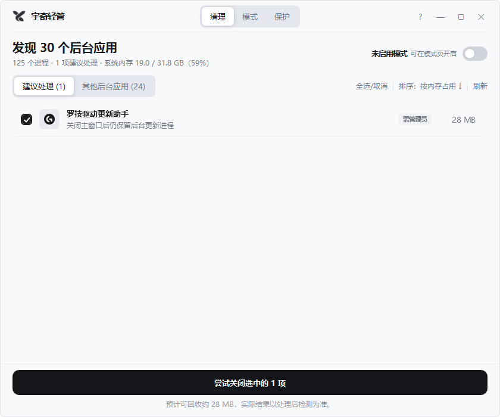

<p align="center">
  
</p>

<h1 align="center">宇奇轻管 · Yuqi Lite</h1>

<p align="center">
  一个极简、诚实的 Windows 后台应用清理工具。<br/>
  把看不懂的进程名翻译成人话，告诉你哪些能关、哪些不该碰——并且不撒谎。
</p>

<p align="center">
  
</p>

## 它能做什么

- **按应用归组，而不是按进程**：同一软件的多个子进程合并成一条，附上图标、用途说明与内存占用。内置应用词典 + 文件元数据 + 数字签名三重识别；Windows 系统关键进程默认不出现在列表里。
- **诚实的清理结果**：结束后延迟复核真实进程状态。杀不掉的就直说——被守护组件拉起的标「已重新启动」，服务/SYSTEM 级进程标「需管理员」，绝不把失败包装成绿色的"已关闭"。
- **保护名单**：系统关键进程只读保护；驱动、安全软件等组件自动保护；也可手动把任何应用加入名单。
- **禁止自动重启**：对付"怎么关都关不掉"的流氓后台——加入名单后本软件运行期间持续拦截它复活（你自己打开的窗口不受影响）。
- **模式规则**：可复用的规则集——保留哪些、启动时关哪些、要不要防重启。手动启用，或绑定某个程序启动时自动生效。
- **自启治理**：识别注册表 Run、启动文件夹、计划任务和第三方自启服务（含守护服务），可禁用、留备份、可还原。
- **需要时提权**：遇到服务级进程，一键以管理员身份重启本软件，之后清理、拦截、禁用服务都会真正生效。

## 它不会做什么

- 不碰系统关键进程和受保护应用，误伤为零是设计底线。
- 不常驻后台守护——「禁止重启」等拦截只在本软件运行期间生效，退出即停止。
- 不联网、不收集数据，所有配置都是本机 JSON。

## 下载

前往 [Releases](https://github.com/ZYY817/yuqi-lite/releases) 页面：

- **`YuqiLite-Setup.msi`** — 安装版，装完在开始菜单出现「宇奇轻管」
- **`YuqiLite-Portable.zip`** — 免安装绿色版，解压即用（入口：`MemoryKeeper.Shell.exe`）

要求 Windows 10/11 x64，已安装 [.NET 8 桌面运行时](https://dotnet.microsoft.com/download/dotnet/8.0)。

> 首次安装/运行时 Windows 可能提示 SmartScreen 或发布者未知——这是未签名小软件的正常提示，选择"仍要运行"即可。

## 从源码构建

```bash
git clone https://github.com/ZYY817/yuqi-lite.git
cd yuqi-lite
dotnet build MemoryKeeper.slnx -c Release
dotnet publish src/MemoryKeeper.Shell -c Release -o publish
```

技术栈：C# / .NET 8 / WPF，模块化架构（Contracts / Core / Shell / Modules），数据落在 `%LocalAppData%\MemoryKeeper\`。

## License

MIT
